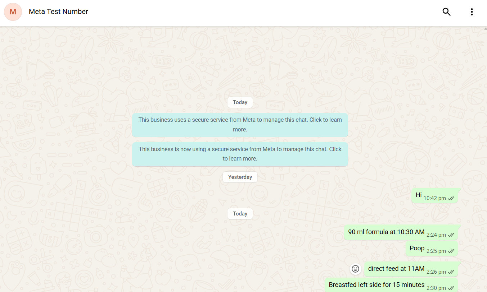
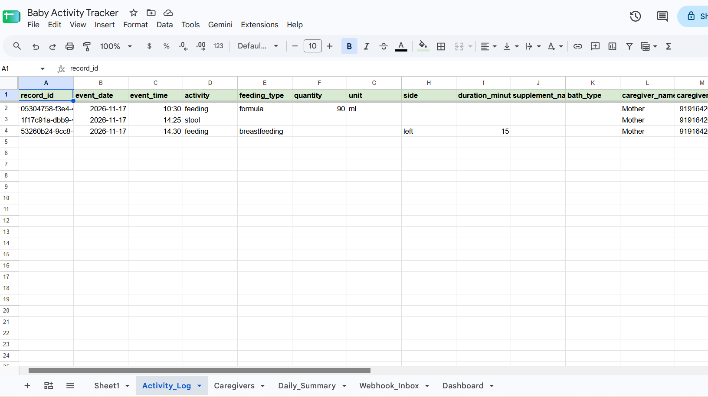
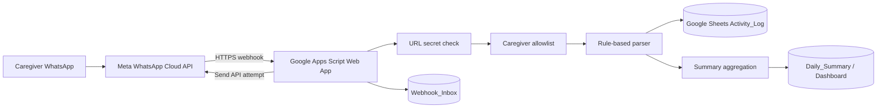

# WhatsApp Baby Tracker

A lightweight, WhatsApp-first baby activity logging MVP built with **Meta WhatsApp Cloud API**, **Google Apps Script**, and **Google Sheets**.

The current implementation accepts caregiver text messages, checks the sender against an allowlist, parses supported activity phrases, and records activities in a Google spreadsheet. `HELP`, `SUMMARY`, and `SUMMARY YESTERDAY` command branches exist in code; live WhatsApp reply delivery for these commands has not been verified.

> **Checkpoint release:** This repository documents the working MVP as verified on 17 November 2026. It is a learning/personal-family logging utility, not a medical device, clinical record, or source of medical advice.


## Verified end-to-end workflow

The screenshots below document the **17 November 2026** manual end-to-end test using the Meta WhatsApp test number, the Apps Script webhook, and Google Sheets.

### 1. Caregiver sends activity messages through WhatsApp

The WhatsApp conversation shows these messages sent from the caregiver's WhatsApp client:

- `90 ml formula at 10:30 AM`
- `Poop`
- `direct feed at 11AM`
- `Breastfed left side for 15 minutes`



**Evidence boundary:** This screenshot proves the messages were sent from WhatsApp. It does not prove that every message was accepted or recorded.

### 2. Activities appear in Google Sheets

The `Activity_Log` screenshot shows three recorded rows:

| WhatsApp input | Recorded activity | Recorded fields |
|---|---|---|
| `90 ml formula at 10:30 AM` | `feeding` | `formula`, `90 ml`, `10:30` |
| `Poop` | `stool` | Event date and time |
| `Breastfed left side for 15 minutes` | `feeding` | `breastfeeding`, `left`, `15 minutes` |



**Parser observation:** `direct feed at 11AM` is visible in the WhatsApp screenshot, but no corresponding row appears in the displayed `Activity_Log`. The checkpoint parser does not support this phrase. Do not count it as a successful recording; parser support remains an enhancement.

### What this evidence establishes

- Real WhatsApp-originated messages reached the configured integration.
- Formula feeding, stool, and breastfeeding records were visible in `Activity_Log`.
- Breastfeeding side and duration were stored in separate fields.
- The `direct feed at 11AM` phrase was not recorded in the displayed sheet snapshot.

This is historical manual-test evidence, not a substitute for a repeatable automated end-to-end test. Outbound WhatsApp acknowledgements and summary replies remain unverified; Meta previously returned error `131031` for an outbound send attempt.


## Verified end-to-end behaviour

The following real WhatsApp-to-Sheets path was exercised:

1. A caregiver sent `90 ml formula at 10:30 AM`.
2. Meta delivered a `messages` webhook event to the Apps Script Web App.
3. Apps Script authenticated the sender against the `Caregivers` sheet.
4. The parser classified the message as formula feeding.
5. An activity row was appended to `Activity_Log`.
6. `Webhook_Inbox` recorded the inbound message as `RECORDED`.

A later real message, `Breastfed left side for 15 minutes`, was also recorded with `feeding_type=breastfeeding`, `side=left`, and `duration_minutes=15`.

Dry-run verification also passed for caregiver authorization, seven parser examples, seven activity writes, and daily summary aggregation. See [TESTING.md](docs/TESTING.md).

## Architecture at a glance



A rendered SVG is available at [`assets/architecture.svg`](assets/architecture.svg). The detailed diagrams and boundaries are in [ARCHITECTURE.md](docs/ARCHITECTURE.md) and [SYSTEM_DESIGN.md](docs/SYSTEM_DESIGN.md).

## Repository layout

```text
whatsapp-baby-tracker/
├── README.md
├── CHANGELOG.md
├── CONTRIBUTING.md
├── SECURITY.md
├── .gitignore
├── appsscript.json
├── src/
│   └── Code.gs
├── docs/
│   ├── ARCHITECTURE.md
│   ├── TECHNICAL_OVERVIEW.md
│   ├── SYSTEM_DESIGN.md
│   ├── DEPLOYMENT.md
│   ├── CONFIGURATION.md
│   ├── DATA_DICTIONARY.md
│   ├── TESTING.md
│   ├── OPERATIONS_RUNBOOK.md
│   ├── SECURITY.md
│   ├── LIMITATIONS_AND_ROADMAP.md
│   └── ADR/
│       └── 0001-mvp-architecture.md
├── tests/
│   └── TEST_CASES.md
└── assets/
    └── architecture.svg
```

## Quick start

### Prerequisites

- A Google account that can create and deploy Apps Script Web Apps.
- A Google spreadsheet for the tracker.
- A Meta developer app with the WhatsApp Business Account use case and a configured WhatsApp Cloud API phone number.
- A Meta access token with the required WhatsApp permissions.
- A verified recipient/tester number where required by Meta's current test setup.
- A caregiver phone number in E.164 digits-only format.

### Setup summary

1. Create or open a Google spreadsheet.
2. Open **Extensions → Apps Script**.
3. Copy `src/Code.gs` into the Apps Script editor.
4. Set the project time zone to the intended local time zone (for this deployment, use `Asia/Kolkata` if that matches the caregiver location).
5. Add the Script Properties documented in [CONFIGURATION.md](docs/CONFIGURATION.md).
6. Run `setupBabyTracker()` once and authorize the requested Google permissions.
7. Populate the `Caregivers` tab. Use digits-only international phone numbers, for example `15550101234`, and set `enabled` to `YES`.
8. Deploy as a Web App. Execute as **Me**; access must permit Meta to reach the endpoint. Review the exposure implications in [SECURITY.md](docs/SECURITY.md).
9. Configure the Meta WhatsApp Business Account webhook callback URL and verify token.
10. Subscribe to the `messages` webhook field.
11. Send a supported message from an authorized WhatsApp number and verify `Activity_Log` and `Webhook_Inbox`.

Detailed, ordered instructions are in [DEPLOYMENT.md](docs/DEPLOYMENT.md).

## Supported message examples

| Message | Parsed activity |
|---|---|
| `90 ml formula at 10:30 AM` | Formula feeding, 90 ml, 10:30 |
| `60 ml expressed milk` | Expressed milk, 60 ml |
| `Breastfed left side for 15 minutes` | Breastfeeding, left side, 15 minutes |
| `Wet diaper` | Urine / wet diaper |
| `Baby passed stool` | Stool / dirty diaper |
| `Vitamin D given` | Supplement dose |
| `Baby had body bath` | Bath |
| `HELP` | Help text |
| `SUMMARY` | Current-day aggregate |
| `SUMMARY YESTERDAY` | Previous-day aggregate |

The parser is deliberately rule-based. It does not call an LLM. The phrase `direct feed at 11AM` was observed not to match the current parser; use a supported phrase until that enhancement is implemented.

## Important current-state notes

- **Inbound path:** real WhatsApp messages were successfully recorded in Google Sheets during the checkpoint test.
- **Outbound path:** Meta previously returned error `131031` (`Business Account locked`) for an outgoing message. The Apps Script attempts to send acknowledgements, but outbound delivery is not verified and must be treated as blocked until Meta resolves the account state.
- **Meta account diagnostics:** a prior WABA health response showed WABA `can_send_message=BLOCKED`, Business `LIMITED`, and App `AVAILABLE`. The payment-method error `141006` specifically described a block on business-initiated conversations. These are Meta account restrictions, separate from the successful inbound record path.
- **App mode:** the Meta dashboard warned that an unpublished app receives dashboard-generated test webhooks but not production events. The real inbound test in this checkpoint did reach Sheets. Re-check current Meta app mode and account status before relying on the integration.
- **Webhook signature:** the current Apps Script `doPost(e)` checks a URL query secret and caregiver allowlist, but does **not** validate Meta's `X-Hub-Signature-256` header. Apps Script's standard web-app event object does not expose arbitrary inbound request headers. This is a known security limitation; do not describe the current endpoint as signature-verified.
- **Data destination:** Google Sheets is the operational datastore. This repository does not include a database migration layer, queue, or separate backend.
- **Medical use:** do not use this MVP to make feeding, medication, or health decisions. Validate entries against the caregiver's actual observations.
  
## Documentation index

- [Architecture](docs/ARCHITECTURE.md)
- [Technical overview](docs/TECHNICAL_OVERVIEW.md)
- [System design](docs/SYSTEM_DESIGN.md)
- [Deployment guide](docs/DEPLOYMENT.md)
- [Configuration reference](docs/CONFIGURATION.md)
- [Data dictionary](docs/DATA_DICTIONARY.md)
- [Testing and verification](docs/TESTING.md)
- [Operations runbook](docs/OPERATIONS_RUNBOOK.md)
- [Security model](docs/SECURITY.md)
- [Known limitations and roadmap](docs/LIMITATIONS_AND_ROADMAP.md)
- [Contribution standards](CONTRIBUTING.md)

## License

No open-source license has been selected for this checkpoint. Add a license only after choosing the terms under which you want others to use, modify, and distribute the project.


## Audit and handover

- [Implementation state and code audit](docs/CODE_AUDIT.md)
- [Test report](docs/TEST_REPORT.md)
- [Implementation handover](docs/IMPLEMENTATION_HANDOVER.md)
- [Enhancement backlog](docs/ENHANCEMENT_BACKLOG.md)

The repository includes a Node.js parser regression harness. It tests the actual Apps Script source in a mocked runtime. It does **not** emulate Google Sheets, Meta webhook delivery, Apps Script quotas, or Meta message delivery. Those require the deployed integration and remain separate manual acceptance tests.

`.env.example` is a reference for Script Properties only. Apps Script does not automatically load `.env` files. There are no third-party Node runtime dependencies; `package.json` provides local test commands.
