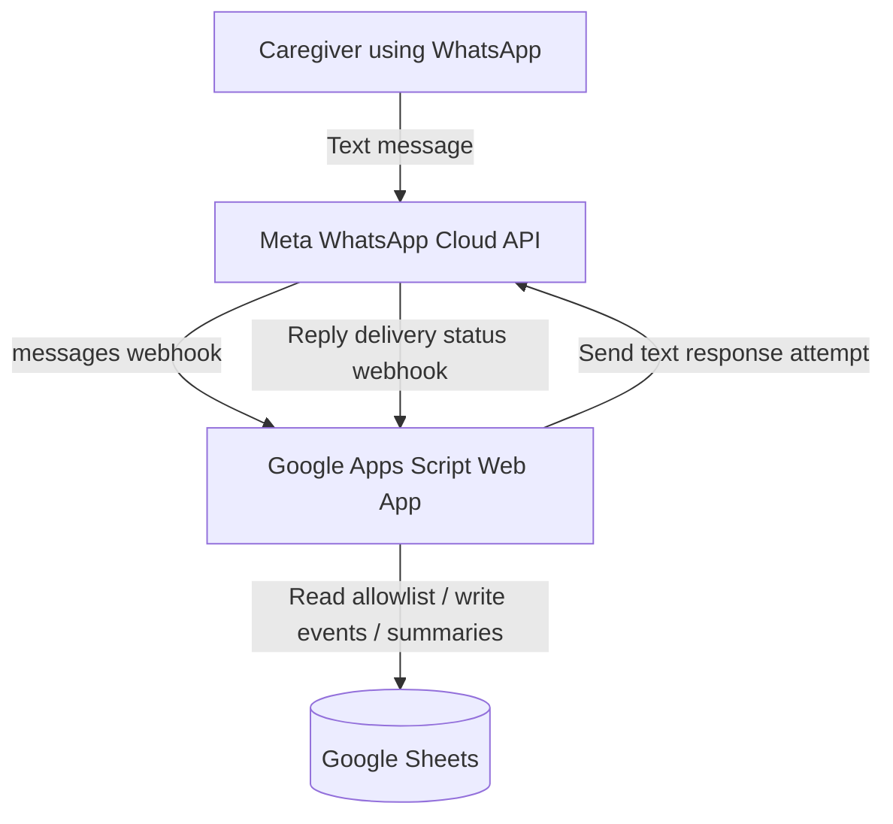
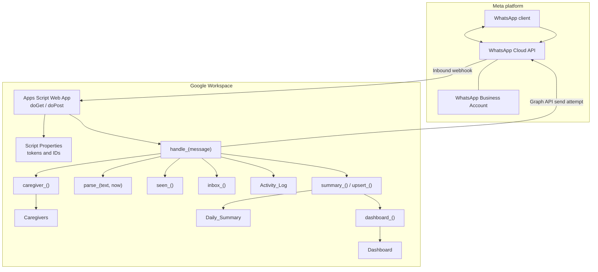
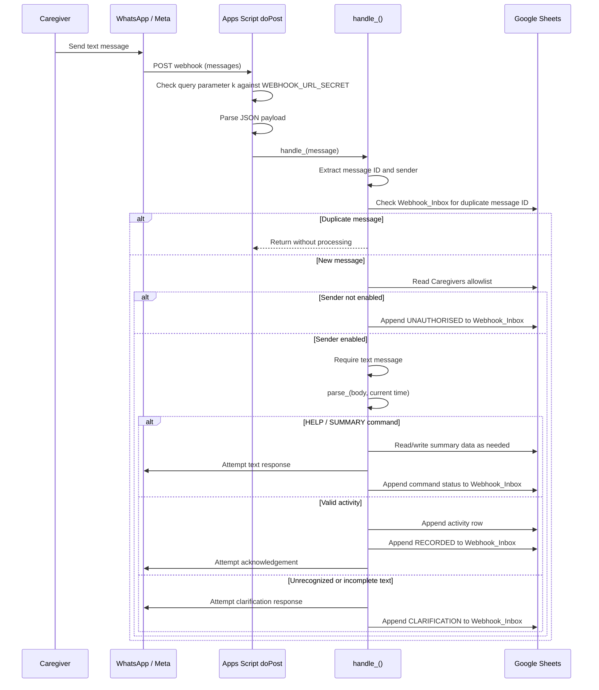
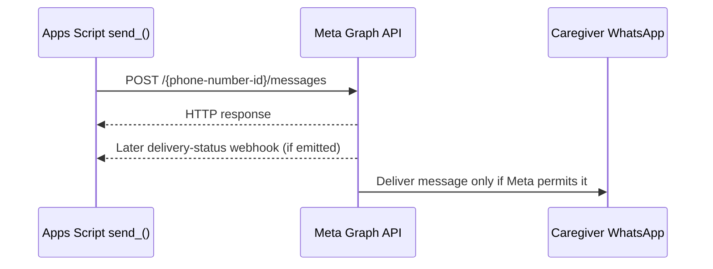

# Architecture

## 1. Purpose and scope

The MVP provides a low-cost, WhatsApp-first interface for caregivers to record baby-care events. Google Apps Script hosts the webhook handler and business logic. Google Sheets stores the event log and daily aggregates.

The system is intentionally small:
- No standalone server.
- No container runtime.
- No database service other than Google Sheets.
- No LLM or external NLP service.
- No background worker or message broker.

## 2. Context diagram

## 3. Container/component diagram

## 4. Inbound message sequence

## 5. Outbound message sequence

The code calls the Graph API `/messages` endpoint using `WHATSAPP_ACCESS_TOKEN` and `WHATSAPP_PHONE_NUMBER_ID`. HTTP errors are logged with `console.error`; they are not converted into a successful delivery guarantee.

Current observed limitation: Meta returned status `failed` with error `131031` (`Business Account locked`). Therefore, inbound event recording and outbound reply delivery are separate acceptance criteria.

## 6. Trust boundaries

| Boundary | Data crossing it | Current control | Gap |
|---|---|---|---|
| Caregiver → Meta | WhatsApp message | WhatsApp account access | Caregiver identity is represented by sender number |
| Meta → Apps Script | Webhook JSON | URL query secret | No `X-Hub-Signature-256` verification |
| Apps Script → Sheets | Personal activity data | Google account permissions | Spreadsheet sharing and Apps Script ownership must be restricted |
| Apps Script → Meta | Access token and message payload | Script Properties; HTTPS | Token lifecycle and Meta account restrictions |
| Caregiver → application logic | Sender number and message body | Allowlist with enabled flag | Number recycling / lost-device processes are not implemented |

## 7. Deployment topology

One Apps Script project is deployed as a Web App. Its script properties contain the spreadsheet ID, Meta identifiers, token, verify token, and URL secret. The Web App accesses the spreadsheet using the deploying user's authority.

There is no separate staging environment in the current deployment. Use a separate spreadsheet and separate Apps Script deployment for experiments that could write to live family records.
