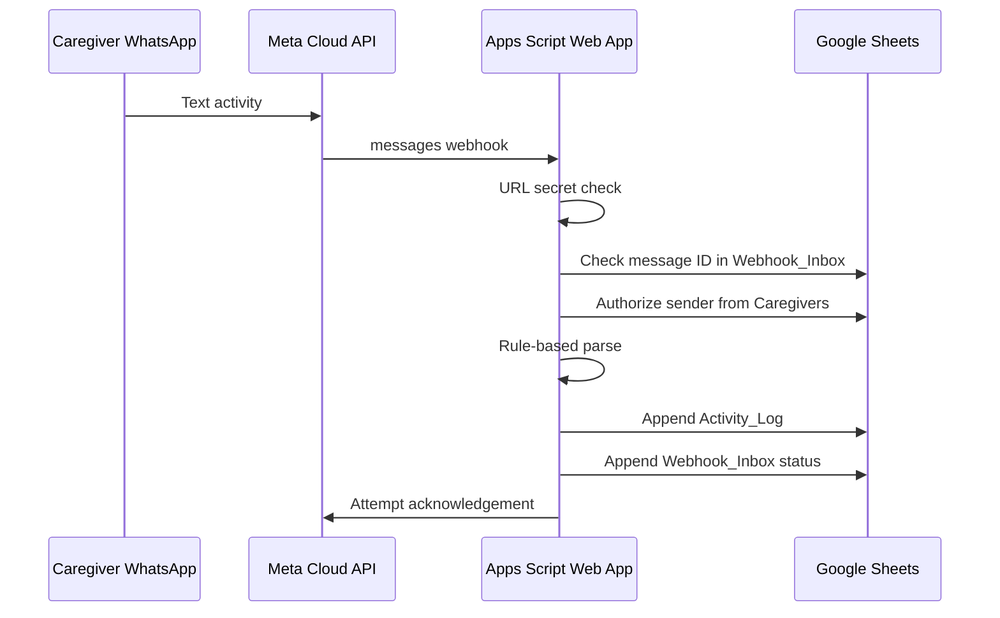

# Implementation Handover

## 1. What this system is

A personal/family WhatsApp baby activity logger implemented with Meta WhatsApp Cloud API, Google Apps Script, and Google Sheets. It is rule-based and intentionally avoids a separate cloud server, Docker host, Python service, or LLM.

## 2. Current operational path

## 3. Sheet tabs

- `Activity_Log`: one row per accepted activity.
- `Caregivers`: sender-number allowlist.
- `Daily_Summary`: daily aggregate values.
- `Dashboard`: charts rebuilt during SUMMARY handling.
- `Webhook_Inbox`: message ID and processing status; also used for deduplication.

## 4. Configuration

The Apps Script project uses Script Properties, not a local `.env` file:
- `SPREADSHEET_ID`
- `WHATSAPP_ACCESS_TOKEN`
- `WHATSAPP_PHONE_NUMBER_ID`
- `WHATSAPP_API_VERSION`
- `WHATSAPP_VERIFY_TOKEN`
- `WEBHOOK_URL_SECRET`

The repository's `.env.example` is a naming/reference aid only. It must not be uploaded to Apps Script or populated and committed.

## 5. Verified message syntax

- `90 ml formula at 10:30 AM`
- `60 ml expressed milk`
- `Breastfed left side for 15 minutes`
- `Wet diaper`
- `Baby passed stool`
- `Vitamin D given`
- `Baby had body bath`
- `HELP`
- `SUMMARY`
- `SUMMARY YESTERDAY`

The first seven activity examples passed parser tests. Real WhatsApp inbound messages were verified for formula, stool, and breastfeeding. Command reply delivery was not verified.

## 6. Known operational blocker

Meta returned `131031 Business Account locked` for an outgoing message. Do not assume acknowledgements or summary replies reach WhatsApp until a fresh outbound test returns success and a delivery status is observed.

Inbound message recording was nevertheless verified in the user's live Google Sheet.

## 7. Safe next actions

1. Preserve the checkpoint and spreadsheet copy.
2. Confirm deployed Apps Script code matches `src/Code.gs`.
3. Confirm Script Properties privately; do not send their values in chat or GitHub.
4. Confirm the Apps Script time zone.
5. Continue using supported message phrases.
6. Treat the Google Sheet as the source of truth; verify each event in Activity_Log.
7. Do not rerun Dry-run 06 cleanup unless the `2099-12-31` summary row has been inspected.
8. Address the backlog in priority order, starting with correctness/security and not adding product features during this checkpoint.

## 8. Evidence boundary

The live spreadsheet, Meta Developer dashboard, and deployed Apps Script project were not directly queried during this audit. Live results in this handover are based on the user's logs and screenshots from 17 November 2026. The local regression tests were run independently against the supplied source.
